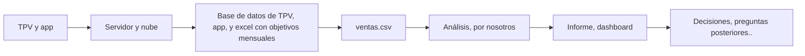

# Café Lumen: ciclo de vida del dato

**Bloque 1 · Sesión 1.1.1** · 27-10-2026

## Contexto

Café Lumen es una cadena de cafeterías cuya directora de operaciones
que quiere empezar a tomar decisionesbasados en datos y no en intuición.
Nos ha contratado con tres preguntas:

¿Cómo vamos? Qué indicadores debería mirar la dirección cada mes y cómo se calculan.
¿Por qué junio fue peor que mayo? Las ventas bajaron y nadie sabe explicar por qué.
¿Está funcionando la app? Seis meses después del lanzamiento
¿merece la pena seguir invirtiendo en ella?

## Datos recibidos

| Archivo | Qué contiene | Filas |
|---|---|--:|
| objetivos_mensuales.csv | Contiene los objetivos mensuales para cada tienda para los primeros 6 meses de 2025. | tienda_id,mes,objetivo_ventas_eur |
| productos.csv | Contiene todos los productos que se venden en las tiendas | producto_id,producto,categoria,precio_venta,coste_unitario |
| tiendas.csv | Contiene informaci¡on sobre cada una de las tiendas. | tienda_id,nombre,ciudad,tipo_ubicacion,fecha_apertura,superficie_m2,plazas_sentado |
| ventas.csv | Contiene todas las ventas de todas las tiendas y del app. | linea_id,ticket_id,fecha,hora,tienda_id,canal,cliente_id,producto_id,producto,categoria,cantidad,precio_unitario,descuento_pct,importe,estado_ticket,valoracion_ticket |

## Ciclo de vida

| Fase | En Café Lumen | Responsable |
|---|---|---|
| 1. Generación | Del TPV y de la app. | Los trabajadores de turno para el TPV y el proveedor de nube para el app |
| 2. Ingesta | Cada noche, los TPVs mandan un informe al servidor central. Los pedidos de la app ya viven en la nube | El equipo de sistemas y el proveedor de nube. |
| 3. Almacenamiento | Están repartidos en tres sitios: la base de datos del tpv, la de la app, y un excel donde la dirección financiera apunta los objetivos mensuales | Equipo de sistemas, el proveedor de nube, y la dirección financiera |
| 4. Transformación | La transformación de los datos dispersos a nuestro ventas.csv | El departamento de sistemas |
| 5. Análisis | El trabajo encargado a nosotros | Nosotros (analistas de datos) |
| 6. Visualización | Un informe mensual de una página, y más adelante un dashboard | Nosotros y desarrolladores BI. |
| 7. Decisión | Las decisiones que se toman a partir de los datos (que pueden ser: ajustar horarios, cambiar la carta de verano, decidir si se sigue invirtiendo en la app) | La dirección de Café Lumen |

## Primeras observaciones

- Ventas.csv es un archivo muy grande y difícil de analizar
- La tienda de Valencia, en un campus universitario, tiene la menor cantidad de ventas aunque tiene el espacio más grande de todas las tiendas
- La tienda de Madrid es la única que tiene objetivos mensuales lineares que van hacia arriba.

## Preguntas para el equipo de sistemas

- ¿qué significa que un ticket esté "Anulado"?
- ¿por qué hay filas sin cliente_id?
- ¿el importe lleva IVA?
- ¿los objetivos se fijaron antes o después de empezar cada mes?
- ¿Cuál es la diferencia entre coste unitario y precio venta?
